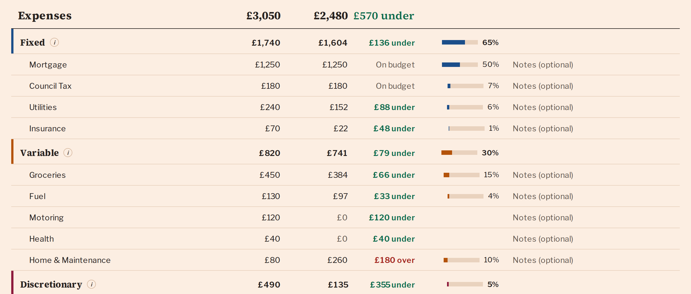
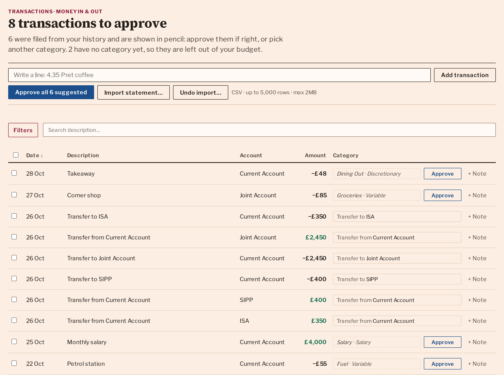

# Balanced Money

[](https://github.com/JRRS1982/halcyon/actions/workflows/ci.yml)
[](LICENSE)
[](https://github.com/JRRS1982/halcyon/actions/workflows/lighthouse-badges.yml)
[](https://github.com/JRRS1982/halcyon/actions/workflows/lighthouse-badges.yml)
[](https://github.com/JRRS1982/halcyon/actions/workflows/lighthouse-badges.yml)
[](https://github.com/JRRS1982/halcyon/actions/workflows/lighthouse-badges.yml)

**Personal finance, made clear.** Live at **<https://balanced.money>**.

Most people trying to get a grip on their money build a spreadsheet, then
quietly abandon it around month three. Balanced Money is that spreadsheet with
the boring parts already done: the structure, the formulas, and the charts. You
still bring the numbers — what you don't have to do is decide how to organise
them.

It never connects to your bank. There is no Open Banking link and no third party
with read access to your accounts: figures get in via a CSV you export yourself,
or by typing.

> The repository is named **halcyon**; the product it ships is **Balanced
> Money**. Same thing — the repo name predates the brand.


## What it does

| | |
| --- | --- |
| **Transactions** | Export a CSV from your bank and import it, or write a line for cash. Rows you've already imported are detected and skipped, so overlapping exports are safe, and every import is a batch you can undo in one click. A merchant you've filed before is filed again in pencil until you approve it. |
| **Budget** | What you meant to spend, month by month, split into Fixed, Variable and Discretionary. Once transactions are categorised the actual column fills itself in beside your plan. Two more kinds of row sit alongside: a **repayment** at a debt you owe, which counts as spending, and a **transfer** into an account you own, which does not — a pension contribution is money you still have. Both feed the long-range plan. |
| **Balance** | What you own and what you owe, sorted by how soon it matters — current, medium-term, long-term, property. The bottom line is your net worth. |
| **Dashboard** | Read-only, and derived: cash flow, savings rate, spending by category and net worth over time, all drawn from the months filled in elsewhere. |
| **Plan** | The long view. Project income, spending, property, mortgages and pensions decades ahead to see whether the money lasts. It starts from your accounts and budget, and refreshes from them when you press Sync. |
| **Settings** | Currency and number format, light/dark/system, which charts appear, categories and accounts — plus a full JSON export of your data and a permanent delete. |

There is a guide at [`/guide`](https://balanced.money/guide) explaining the
monthly rhythm the app is built around, reachable without an account.

<details>
<summary>More screenshots</summary>






</details>

## Project docs

Built as a learning project, and documented like one. Start with the
[Playbook](docs/playbook.md) for how it was approached, or the
[docs](docs/) directory for architecture and design.

## Deployment

- **Development**: <http://localhost:3210/> (`pnpm dev` or `make up`).
- **Production**: <https://balanced.money> (also served on the Vercel default domain, <https://halcyon-silk.vercel.app>).
- **Hosting**: [Vercel](https://vercel.com) runs the Next.js app (App Router server components + route handlers + middleware). [Supabase](https://supabase.com) provides managed Postgres and Auth. See [ADR-001](docs/adrs/adr-001-tech-stack-selection.md) for the rationale.
- **Email**: outbound (the opt-in monthly reminder) goes through [Resend](https://resend.com); inbound (the `hello@balanced.money` contact address named in the legal pages) is [ImprovMX](https://improvmx.com) forwarding — MX + SPF records live in Vercel DNS, the forwarding destination in the ImprovMX dashboard. See [docs/engineering/contact-email.md](docs/engineering/contact-email.md).
- **Pipeline**: pushes to `master` trigger GitHub Actions ([`.github/workflows/ci.yml`](.github/workflows/ci.yml)) which runs `biome ci`, `tsc --noEmit`, Jest, and Playwright on Node 22 + pnpm 11. Vercel watches `master` independently and ships the build to production once its own build passes.
- **Database migrations**: applied by GitHub Actions, not by the host. The `migrate-prod` job in [`.github/workflows/ci.yml`](.github/workflows/ci.yml) runs `prisma migrate deploy` against the production `DIRECT_URL` (unpooled Supabase connection, port 5432, supplied via the `PROD_DIRECT_URL` repo secret) — but only on push to `master` and only after lint/test + e2e pass. Vercel is configured to wait for this workflow before deploying, so the new code never goes live against an un-migrated schema. Migrations are forward-only; to undo, write a corrective migration. Manual fallback: `pnpm exec prisma migrate deploy` with `DIRECT_URL` set.
- **Rollback**: one click in the Vercel dashboard (it keeps every previous build immutable). Pair with a corrective DB migration if a release introduced a schema change.
- **Secrets**: managed in the Vercel project settings, not committed. [`.env.example`](.env.example) lists every variable and where it is set in each environment (Vercel, GitHub secrets, Supabase dashboard, local files). See also [ADR-004](docs/adrs/adr-004-secret-management.md).

## Setup

Install dependencies with pnpm, then run the app **in Docker** for local development (this is what points it at the local database — see below):

```bash
  pnpm install      # install dependencies
  make build        # first run: build images, start Docker, migrate + seed (http://localhost:3210)
  # thereafter:  make            # start the app and local Postgres (attached)
```

### Commands — `make` vs `pnpm`

- **`make` for the app + the database** (runs inside Docker, against local Postgres): `make` / `make build` (first-run setup) / `make up` / `make down` / `make rebuild`, `make migrate-create name=<verb_table>` (author a new migration), `make migrate-deploy` (apply pending migrations), `make db-reset`, `make db-seed`, `make db-shell`.
- **`pnpm` for stateless checks** (faster, and what CI runs): `pnpm typecheck`, `pnpm check` (lint+format), `pnpm test`, `pnpm build`, `pnpm verify`.
- **Migrations: always `make migrate-create` / `make migrate-deploy`, never host `pnpm prisma …`** — see the gotcha below.

### Which database am I hitting?

Two databases exist: **local Postgres** (the Docker `db` service) and **production Supabase**. Production DB URLs live only in Vercel env vars and CI secrets — no local file holds them. Locally it shakes out as:

| Command | Reads | Hits |
| --- | --- | --- |
| App in Docker — `make up` | `compose.yaml` env (local) | **local** |
| App on host — `pnpm dev` (Next.js) | `.env.development` → `.env` | **local** |
| Prisma CLI on host — `pnpm prisma …` | nothing (`prisma.config.ts` loads no env file) | **fails loudly** |

Two local env files, two roles: `.env.development` (committed) holds non-secret defaults — the local DB URL; the gitignored `.env` holds only the Supabase auth values (URL + keys, **no DB URLs**) — it's also the only file Docker Compose can interpolate `${...}` from, which is why the secrets live there and not in a `.env.local`.

Prisma migrations always run inside the container — **`make migrate-create` / `make migrate-deploy`** — where `compose.yaml` pins `DATABASE_URL`/`DIRECT_URL` to the local `db` service. A stray host `pnpm prisma migrate` fails loudly (no connection string) instead of silently touching anything.

## Documentation

I have done my best, with the support of AI to put a comprehensive set of documents in place to help me and others understand the project and its architecture.

- [Tech Stack](docs/adrs/adr-001-tech-stack-selection.md)
- [Playbook](docs/playbook.md)
- [Data Models](docs/data-models/data-models.md)
- [Architecture Decision Records (ADRs)](docs/adrs/)
- [Security Architecture](docs/adrs/adr-002-security-architecture.md)
- [Row Level Security](docs/engineering/row-level-security.md) — the two doors into the data, and the hand-written step Prisma can't generate
- [Auth Flow (sequence diagrams)](docs/features/auth.md)
- [User Personas](docs/user-personas.md)
- [User Journeys](docs/user-journeys/)
- [Stakeholder Mapping](docs/stakeholder-mapping.md)
- [Success Metrics](docs/success-metrics.md)
- [Data Privacy Statement](docs/data-privacy-statement.md)
- [Design System (DESIGN.md)](DESIGN.md)
- [Accessibility Standards](docs/accessibility-standards.md)

## Testing

The unit tests run against the code in the `src/` directory, rather than the container code, which improved the speed and reliability of the tests. In other projects i have worked on, running tests against the container code was a common source of frustration.

Tests sit beside the file they test: `period.test.ts` next to `period.ts`,
`actions.createPlan.integration.test.ts` next to `actions.ts`. Only the e2e
suite and the integration harness live in `tests/`. A unit test
(`src/lib/ci/testSiblings.test.ts`) fails if any test's subject file is missing.

### Unit tests

To run the unit tests, use the following command: `pnpm test`, or one of the helpers listed below:

- `make test`
- `make test-watch`
- `make test-coverage`

### Integration tests (real Postgres)

Server actions and DB queries (imports, categorisation, merge, provisioning,
ledger queries) are tested against a **real `halcyon_test` database**, with only
the Supabase auth boundary mocked. Files use the `*.integration.test.ts` suffix and run
in a node-env Jest project, separate from the unit run.

```bash
pnpm test:integration
```

It needs a Postgres reachable at `localhost:5432` (the `db` container from
`make up` is fine — the test database `halcyon_test` lives alongside the dev
`halcyon` DB). The command pins `DATABASE_URL` at `halcyon_test` and a guard
refuses to run against anything else; `globalSetup` applies migrations.

### End to end tests (E2E)

Run the tests locally:

1. Install browser system deps once: `sudo npx playwright install-deps`.
2. Install the project deps: `pnpm install`.
3. Install the browsers if missing: `pnpm exec playwright install chromium`.
4. Run the tests:

   ```bash
   make test-e2e                            # all specs
   make test-e2e name="transfers journey"   # only specs/tests matching the grep
   ```

   `make test-e2e` brings the local Postgres up and migrates `halcyon_test`
   first (see below), then runs Playwright. To run Playwright directly instead:
   `pnpm exec playwright test` (or `--grep "<pattern>"`, or `pnpm test:e2e:ui`
   for the UI runner). Avoid `pnpm test:e2e -- --grep`: the bare `--` reaches
   Playwright, which reads `--grep` as a positional file filter ("No tests
   found").

Playwright spins up two webservers automatically:

- a **mock Supabase Auth server** on `localhost:54321` (see [`tests/e2e/_mock/supabase.mjs`](tests/e2e/_mock/supabase.mjs))
- a **Next.js dev server** on `localhost:3100` (the deliberately-different port lets the test server coexist with a developer's own `pnpm dev` on `:3210`)

Auth is always mocked (no real Supabase project is touched). **DB-touching
journeys** (transactions, transfers) do hit a real `halcyon_test` Postgres at
`localhost:5432`, connecting as `test:test` to match the CI Postgres service.
The `db` container provisions `halcyon_test` and the `test` role automatically
on first volume init (see [`docker/postgres-init.sql`](docker/postgres-init.sql)),
and `make test-e2e` applies migrations to it — so a cold `make test-e2e` works
end to end. Coverage and approach are documented in [`docs/features/auth.md`](docs/features/auth.md#e2e-test-coverage).

### Database Seeding

To seed the local development database, use the following command: `pnpm db:seed`, or one of the helpers listed below to seed and reset the database in the container.

- `make db-seed`
- `make db-reset`

## Marketing screenshots

The front page and feature pages show plates: one section of each app screen, in `public/marketing/plates/`. **Re-capture them whenever the budget, balance, transactions, dashboard, plan or settings UI changes** — they are the first thing a visitor sees, and a stale set advertises a product that no longer exists.

```bash
make db-seed                     # the demo account: twelve months ending this one
make up                          # the app on :3210
node scripts/capture-shots.mjs
```

The script signs in as the seeded demo account and refuses any app that isn't on `localhost`, because the demo password is published in this repo. It shoots the budget and balance on the last complete month. Afterwards, update each plate's `aspect` in `src/lib/editorial/features.ts` (and `budget-lead` in `src/components/marketing/Hero/index.tsx`) to the new pixel sizes, and re-read the alt text there, which quotes that month's figures.

## Contributing

Contributions are always welcome! Please open a pull request or issue to discuss any changes you would like to make.

## Feedback

Issues and pull requests are welcome on
[GitHub](https://github.com/JRRS1982/halcyon/issues).
