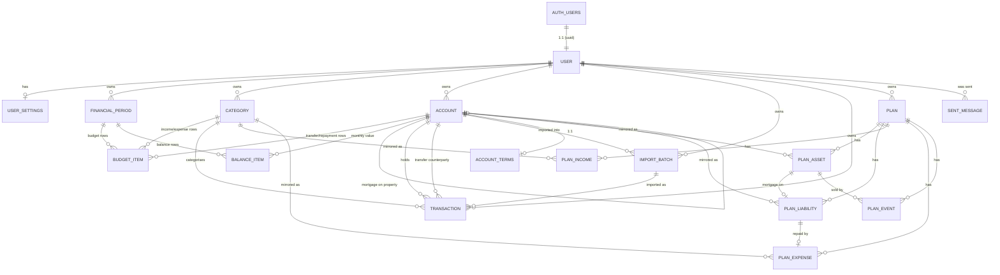

# Data Models

**`prisma/schema.prisma` is the source of truth for columns.** It carries the
comments explaining the non-obvious ones, and it cannot drift from the database.
This document covers what the schema can't say for itself: what each table is
*for*, how ownership flows, and where the auth boundary sits.

> Columns were listed here until 2026-08-10 and had already fallen behind the
> schema in several places, so they were removed rather than repaired. If you
> want to know a table's shape, read the schema.

## Auth boundary

Supabase Auth owns identity, in the Postgres `auth` schema (managed by Supabase,
not by our migrations). The end-to-end sequences are in
[features/auth.md](../features/auth.md); the decision is
[ADR-002](../adrs/adr-002-security-architecture.md).

- `auth.users` is authoritative for email, password, verification state, MFA and
  OAuth identities. **The app never writes to it** — everything goes through
  Supabase Auth APIs via `@supabase/ssr`.
- `public.User` is our profile row, keyed 1:1 to `auth.users(id)`. Domain data
  only.
- **Email addresses are not stored in our tables.** Read them from the session,
  or from `auth.admin` when a job needs one. The monthly reminder does the
  latter; that is not a precedent for copying them.

Consequently there is no `VerificationToken` or `PasswordResetToken` table, and
no password or lockout columns on `User` — Supabase owns all of it. The
`Account` model is unrelated to auth: it is something the user owns or owes
(see below).

## The tables

Every table below is owned by exactly one user, directly via `userId` or through
a parent. Most carry `deletedAt` for soft deletion.

### Periods, budget and balance

| Table | What it's for |
|---|---|
| `User` | profile row; the owner every other table hangs off |
| `UserSettings` | per-user preferences and feature flags, created on first read |
| `FinancialPeriod` | one month — the shared spine for `/budget` and `/balance`. Unique per `(userId, granularity, startDate)`. The enum also allows `WEEK` and `QUARTER`, but every writer creates `MONTH` |
| `BudgetItem` | a budget row in a period, one of four kinds. `INCOME` and `EXPENSE` link a `Category` and carry its `section`; `TRANSFER` (into an asset account, with a direction) and `REPAYMENT` (at a liability) link an `Account` instead. Budgeted vs actual |
| `BalanceItem` | one month's value for one `Account`: value, notes, and a `carriedOver` flag for values copied from last month. The partial unique index `BalanceItem_period_account_live` allows one live row per account per month |

`BudgetItem.categoryId` is nullable: transfer and repayment rows key on an
account instead, and older free-typed rows have neither. `label` is the
fallback either way.

### Accounts and categories

| Table | What it's for |
|---|---|
| `Account` | the registry of everything a user owns or owes — current accounts, savings, ISAs, pensions, property, mortgages, loans. `type` is the one stored fact; asset-or-liability (`kind`) and tax wrapper (`wrapper`) are derived from it in code (`kindOf`/`wrapperOf`), never stored. `section` is the user-editable balance-sheet group. `linkedAccountId` pairs a mortgage with its property. See [features/accounts.md](../features/accounts.md) |
| `AccountTerms` | 1:1 with `Account` (its `accountId` is the primary key): the projection parameters the account feeds into the Plan — expected return, fees, interest rate, a mortgage's revision terms, a final-salary entitlement. Blank means "take the default", never "unknown" |
| `Category` | the stable list of income and spending categories that budget rows and transactions are filed under, each with a `section`. See [features/onboarding.md](../features/onboarding.md) for what a new account starts with |

New `Account` and `Category` rows are created only through
`src/lib/accounts/createWithinCap.ts` and `src/lib/categories/createWithinCap.ts`,
which enforce the per-user caps.

### Transactions

| Table | What it's for |
|---|---|
| `ImportBatch` | one CSV import into one account, so it can be reversed as a unit |
| `Transaction` | an imported or manual line: date, signed amount, description, optional category, and an optional counterparty account when it is a transfer |

### Plan

The forecasting feature (`src/lib/plan/`). A `Plan` is per user; everything else
is per plan and cascades from it.

| Table | What it's for |
|---|---|
| `Plan` | the user's projection: date of birth, retirement age, assumptions, tax regime |
| `PlanAsset` | a pot or property, with a tax wrapper that drives withdrawal tax. Mirrors an `Account` (`accountId`) |
| `PlanLiability` | a debt, mirroring an `Account`; optionally linked to the `PlanAsset` it is secured on (a mortgage) |
| `PlanIncome`, `PlanExpense` | recurring flows, mirroring a budget `Category` (`categoryId`). An expense may be the repayment leg of a liability |
| `PlanEvent` | a one-off at an age — a lump sum, or the sale of a linked property |

Those three optional links (mortgage → property, repayment → liability, sale →
property) are what make a mortgage behave as one thing across three tables. They
are `SetNull` on delete, so removing a property leaves its debt rather than
silently deleting it.

The `accountId`/`categoryId` links are how Sync refreshes a plan from the
budget and balance sheet; each is unique per plan and `SetNull` on delete. A new
plan is seeded the same way, from the user's most recent month — see
`createPlan` in `src/app/(app)/plan/actions.ts`, [features/plan-sync.md](../features/plan-sync.md),
and the warning about the starter month in
[features/onboarding.md](../features/onboarding.md).

### Messaging

| Table | What it's for |
|---|---|
| `SentMessage` | one row per message sent to a user — today only the monthly reminder email — with its result. Included in the data export. See [features/reminders.md](../features/reminders.md) |

## Ownership and access

**Application-level `userId` filtering is the authorization boundary.**
Server-side Prisma connects with a role that bypasses RLS, so every query must
filter by the signed-in user. RLS policies exist on every table as
defence-in-depth, limiting rows to `userId = auth.uid()` (period- and
plan-scoped tables resolve ownership through their parent) — they become the
real fence only if a future feature queries Supabase from the client. When you
add a user-owned model, write both. See
[engineering/row-level-security.md](../engineering/row-level-security.md) and
[ADR-002](../adrs/adr-002-security-architecture.md).

> **Why the schema looks like this.** An earlier draft had a hierarchical
> `FinancialDocument`/`FinancialItem` tree with `parentId`, plus an audit-log
> table. The hierarchy was never built; the shipped design is flat and
> period-based. The flat row it did ship kept the name `FinancialItem` until
> August 2026, when it became `BudgetItem` — so a `FinancialItem` in an old
> commit is that flat row, not the abandoned tree above. An
> earlier version also assumed NextAuth + bcrypt, which
> [ADR-002](../adrs/adr-002-security-architecture.md) replaced with Supabase Auth.
