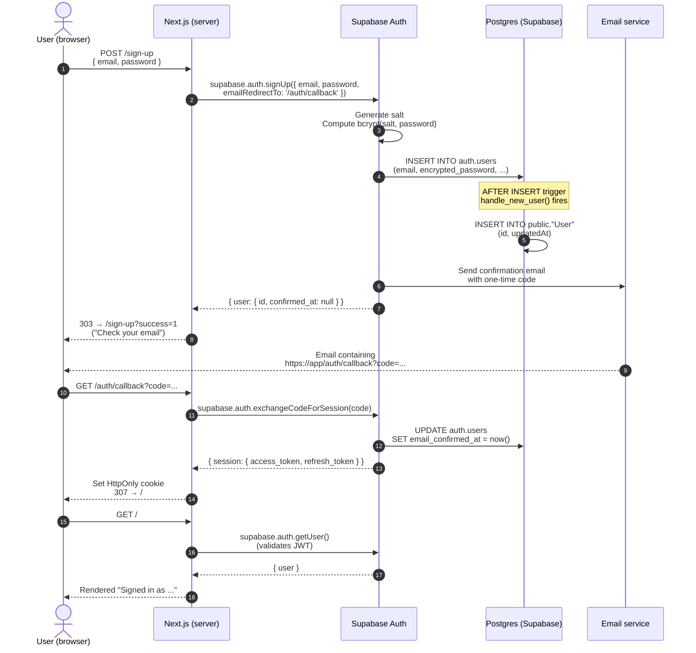
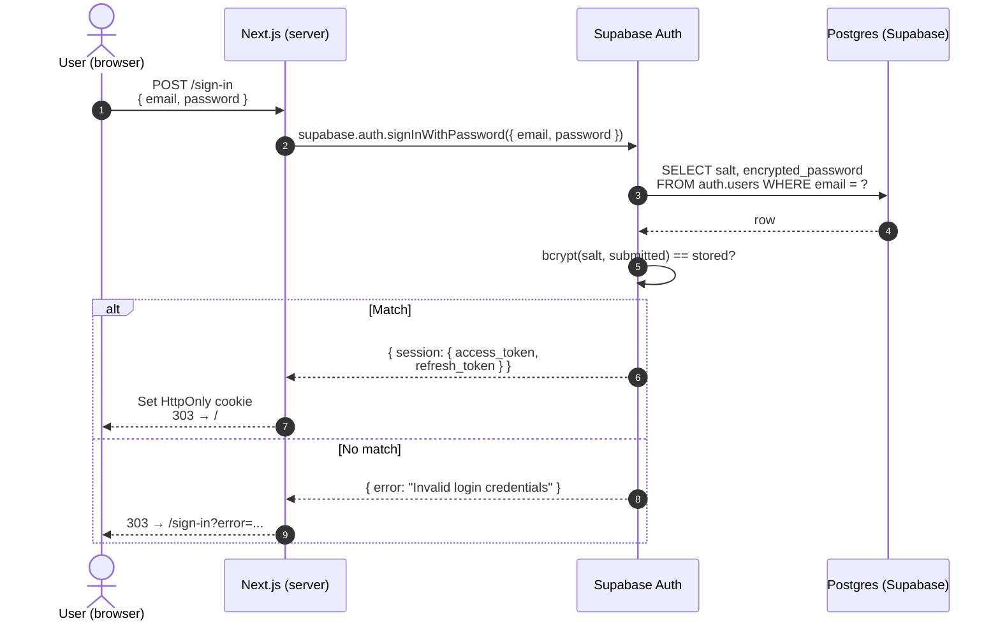
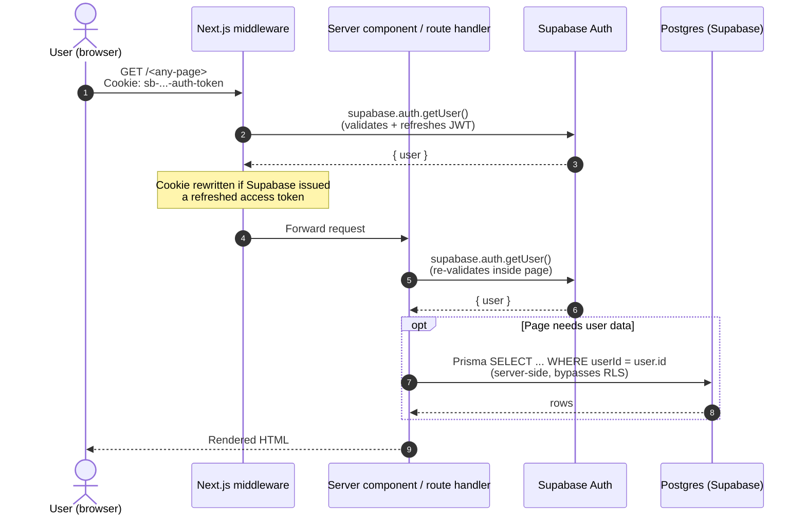
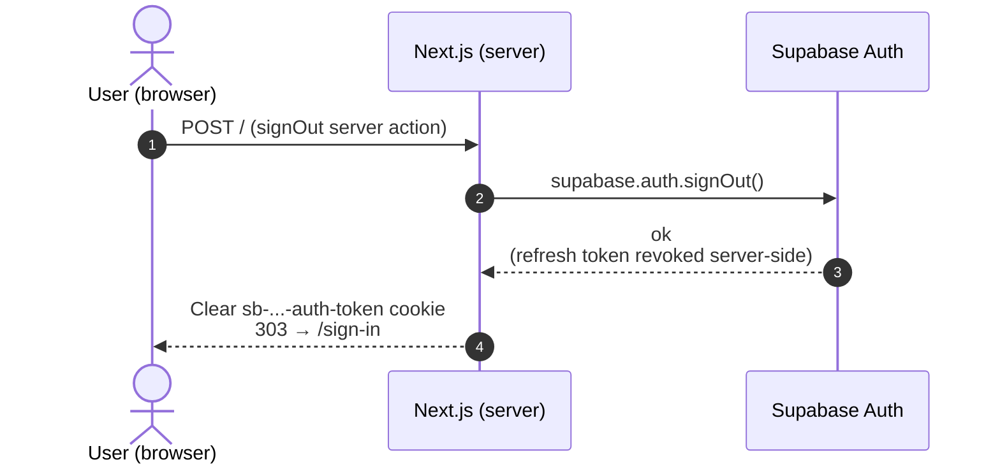
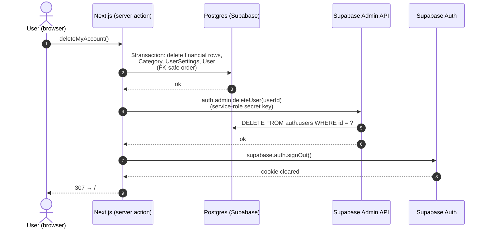

# Authentication Flow

**What:** Supabase Auth (email/password + Google OAuth) integrated into Next.js via `@supabase/ssr`; cookies managed server-side in middleware.  
**Key points:**
- Session lives in `sb-*-auth-token` cookies set by Supabase; `src/proxy.ts` refreshes them on every request
- Route protection: `src/lib/supabase/middleware.ts` checks session and redirects unauthenticated requests to `/sign-in`
- Server actions re-call `requireUserId()` — middleware is not the only fence
- Google OAuth is live; GitHub is configured in code but disabled in the Supabase dashboard

This document explains *what kind* of authentication Halcyon uses, where each piece of state lives, and what happens on the wire during sign-up, sign-in, and sign-out.

See also: [ADR-001 (Tech Stack)](../adrs/adr-001-tech-stack-selection.md), [ADR-002 (Security)](../adrs/adr-002-security-architecture.md), [Data Models](../data-models/data-models.md).

## What kind of auth is this?

**Email/password + Google OAuth via [Supabase Auth](https://supabase.com/docs/guides/auth)**, integrated into Next.js using the [`@supabase/ssr`](https://supabase.com/docs/guides/auth/server-side/nextjs) helpers. Google sign-in is live (provider enabled in the Supabase dashboard — see [Google OAuth setup](#google-oauth-setup)).

The pattern is the **"identity-in-`auth`, profile-in-`public`"** pattern — the canonical way to use Supabase Auth from a relational app. Three concrete consequences:

1. **Identity rows live in `auth.users`**, a table inside the `auth` schema that Supabase owns and that you never write migrations against. It holds the email, the bcrypt-hashed password (`encrypted_password`), the confirmation timestamp, OAuth provider identities, MFA factors, etc.
2. **Profile rows live in `public.User`**, which *we* own. It's keyed 1:1 to `auth.users.id` by `uuid`. It holds app-specific fields (timezone, display name, status, lastActiveAt) that don't belong in Supabase's table.
3. **A Postgres trigger keeps the two in sync.** `on_auth_user_created` fires `AFTER INSERT ON auth.users` and inserts a matching row into `public."User"`. This means a profile row is always created in the same transaction as the auth row — no race conditions, no orphan auth users.

### Why this is best-practice

| Concern | How this pattern handles it |
|---|---|
| Password storage | Supabase Auth uses bcrypt (or Argon2 depending on config) with a unique per-user salt, stored only in `auth.users.encrypted_password`. The application never sees the plaintext or the hash. |
| Session management | Supabase issues a signed JWT after sign-in. `@supabase/ssr` stores it in `sb-*-auth-token` cookies. The library's default is `httpOnly: false` (so a browser-side client can read the session); this app has **no** browser-side Supabase client, so both server constructors pass [`sessionCookieOptions`](../../src/lib/supabase/cookieOptions.ts) — `HttpOnly`, `SameSite=Lax`, `Secure` in production — and client-side JavaScript cannot read the tokens (mitigates XSS-based session theft). Pinned by a unit test in `middleware.test.ts`. |
| Email verification, password reset, OAuth callbacks | Supabase issues and checks every token. The app implements `/auth/callback` (exchanges a one-time code for a session) and `/reset-password` (verifies a recovery token on submit) — see [Password reset](#password-reset). |
| Brute force / credential stuffing | Two layers. Supabase rate-limits its own auth endpoints (tunable in the dashboard), and because every call reaches it from Vercel's shared egress IPs, the app forwards the real client IP so those limits bind per attacker. On top, an app-side limiter ([`src/lib/rateLimit/`](../../src/lib/rateLimit/), Upstash Redis) keys sign-in on both the client IP (10/min) and the submitted email (20/hour), and sign-up on the IP (10/min) and the address (3 confirmation emails/hour). Sign-in fails open when the store is down; sign-up fails **closed**, because every call sends an email. No lockout counters in the app. |
| Authorisation | Two layers: app-level `userId` filtering on every Prisma query (primary boundary, because server-side Prisma bypasses RLS), **plus** Postgres Row Level Security with `auth.uid() = id` policies (defence-in-depth; the real fence if/when a feature ever queries Supabase directly from the browser). |
| Loss of secrets | The DB password and `SUPABASE_SECRET_KEY` are the only secrets that bypass RLS. They live in Vercel project env vars in production and the gitignored `.env` in dev — never in source. |

## Components involved

| Component | Lives in | Role |
|---|---|---|
| **Browser** | User's machine | Submits forms; holds the session cookie. |
| **Next.js middleware** (`src/proxy.ts`) | Vercel edge / local Node | Runs on every request. Calls `supabase.auth.getUser()` to refresh the session cookie. |
| **Server components / route handlers** (`src/app/**`) | Vercel functions / local Node | Render pages and handle form POSTs. Use the server-side Supabase client (`src/lib/supabase/server.ts`). |
| **Supabase Auth** | `<project>.supabase.co` | Hashes passwords, issues JWTs, sends emails, validates OAuth, owns `auth.users`. |
| **Postgres** | Inside Supabase, same project | Stores `auth.users` (Supabase-managed) and `public."User"` (ours). Hosts the `on_auth_user_created` trigger that bridges the two. |
| **Email provider** | Resend, as Supabase's custom SMTP | Sends confirmation, password-reset and re-auth-code emails. Templates live in the Supabase dashboard — see [Supabase email setup](#supabase-email-setup). |

## Sequence diagrams

### Sign-up



### Sign-in (returning user)



### Authenticated request



### Sign-out



## Session length

Supabase Auth issues a 1-hour access token plus a rolling refresh token, and the proxy renews it on every request. Left at that, a session never ends: come back a month later and you are still signed in. Supabase's own controls for this (Auth → Sessions: inactivity timeout, time-box) are Pro-plan only, so the limits are enforced in the app instead.

Two windows, both defined in [`src/lib/auth/sessionTimeout.ts`](../../src/lib/auth/sessionTimeout.ts):

| Window | Value | Meaning |
|---|---|---|
| `idleMs` | 6 hours | No requests for this long ends the session. |
| `absoluteMs` | 24 hours | Hard cap on total session age, however active the user has been. |
| `warnMs` | 60 seconds | How long before idle expiry the browser warns. |

**The server is the fence.** `updateSession` reads a `bm_activity` cookie — `"<startedAt>.<lastSeenAt>"`, httpOnly, `SameSite=Lax` — and calls `evaluateSession` on every authenticated request. Expired means `supabase.auth.signOut()` (so the refresh token is revoked, not merely forgotten), every `sb-*` cookie cleared on the redirect, and `307 → /sign-in?timeout=idle|absolute|unreadable`. Active means the cookie is rewritten with a fresh `lastSeenAt`. This is what catches the closed-browser case.

Two decisions worth knowing before changing any of it:

- **No readable cookie means expired, not new.** `evaluateSession(null)` returns `expired` with reason `unreadable`, and so does an unparseable value. Until October 2026 it returned `active`, which made the cookie trivially defeatable: an attacker replaying stolen `sb-*` cookies simply omitted `bm_activity` on every request and neither limit ever fired. It is the only lifetime bound the app has — Supabase's own session time-box is Pro-only and refresh tokens carry no absolute expiry.
- **Seeding is the job of the paths that mint sessions, not the proxy.** `startActivityClock` (`src/lib/auth/activityClock.ts`) is called by the password sign-in action and by `/auth/callback`, which covers OAuth, email confirmation and magic links. The proxy only ever reads. That split is load-bearing in both directions: if the proxy seeded, the guard above would be pointless; if a session source forgets to seed, its users are signed straight back out.
- **The cookie's `maxAge` is the absolute window, not the idle one.** If the browser dropped it at the idle limit, a visit just past that limit would arrive with no cookie — which now ends the session rather than resurrecting it, but would end it for an innocent reason. Expiry is decided by `evaluateSession`, never by cookie eviction.
- **A missing or unreadable cookie counts as active, not expired.** Treating it as expired would loop forever for any client that cannot store the cookie. The cookie is unsigned for the same reason the trade-off is acceptable: forging it only extends the forger's own session, and they already hold the refresh token that grants it.

**The client is the courtesy.** [`useIdleTimer`](../../src/lib/hooks/useIdleTimer.ts) ticks once a second, re-deriving state from wall-clock timestamps rather than counting elapsed ticks — so a laptop that slept through the window wakes up knowing the session already lapsed. [`IdleTimeout`](../../src/components/auth/IdleTimeout/) renders the 60-second warning as a native `<dialog>` opened with `showModal()`; "Stay signed in" calls `router.refresh()`, whose request passes through the proxy and resets the server's clock as a side effect, so no dedicated action is needed. Tabs share one activity clock over a `BroadcastChannel`, so working in one tab does not let another time out underneath you. Once the warning is up, ordinary activity no longer extends the session — only the explicit button does, because only that path also moves the server's clock.

## Code map

| Concern | File |
|---|---|
| Idle + absolute session limits (pure) | [`src/lib/auth/sessionTimeout.ts`](../../src/lib/auth/sessionTimeout.ts) |
| Client-side idle timer | [`src/lib/hooks/useIdleTimer.ts`](../../src/lib/hooks/useIdleTimer.ts) |
| Idle warning dialog | [`src/components/auth/IdleTimeout/`](../../src/components/auth/IdleTimeout/) |
| Session cookie attributes (HttpOnly etc.), shared by both clients | [`src/lib/supabase/cookieOptions.ts`](../../src/lib/supabase/cookieOptions.ts) |
| App-side rate limiter (sign-in, sign-up, password reset, re-auth, health) | [`src/lib/rateLimit/`](../../src/lib/rateLimit/) |
| Server-side Supabase client (cookies via `next/headers`) | [`src/lib/supabase/server.ts`](../../src/lib/supabase/server.ts) |
| Middleware Supabase client + session refresh helper | [`src/lib/supabase/middleware.ts`](../../src/lib/supabase/middleware.ts) |
| Next.js middleware entry point (`proxy` export) | [`src/proxy.ts`](../../src/proxy.ts) |
| Sign-in page + server action | [`src/app/(app)/sign-in/`](<../../src/app/(app)/sign-in/>) |
| Sign-up page + server action | [`src/app/(app)/sign-up/`](<../../src/app/(app)/sign-up/>) |
| Forgot-password page + server action (sends the link) | [`src/app/(app)/forgot-password/`](<../../src/app/(app)/forgot-password/>) |
| Reset-password page + server action (sets the password) | [`src/app/(app)/reset-password/`](<../../src/app/(app)/reset-password/>) |
| OAuth / magic-link / email-confirmation callback | [`src/app/auth/callback/route.ts`](../../src/app/auth/callback/route.ts) |
| Sign-out server action | [`src/app/actions.ts`](../../src/app/actions.ts) |
| Where sign-in lands (`POST_AUTH_LANDING`) | [`src/lib/auth/landing.ts`](../../src/lib/auth/landing.ts) |
| Profile-row trigger + RLS policies | [`prisma/migrations/20260522130000_supabase_auth_integration/migration.sql`](../../prisma/migrations/20260522130000_supabase_auth_integration/migration.sql) |
| Account-data server actions (export / clear / delete) | [`src/app/(app)/settings/dataActions.ts`](<../../src/app/(app)/settings/dataActions.ts>) |
| Service-role admin client (account erasure) | [`src/lib/supabase/admin.ts`](../../src/lib/supabase/admin.ts) |

## Where a successful sign-in lands

`/transactions`, not `/dashboard` — the constant is `POST_AUTH_LANDING` in
[`src/lib/auth/landing.ts`](../../src/lib/auth/landing.ts), and all three entry
points (the sign-in action, the sign-up flow and `/auth/callback`) default to it.
An explicit `?next=` always wins, so a user bounced off a protected page still
returns there.

Transactions rather than the dashboard because the dashboard is derived: it has
nothing to show until months have been filled in, so sending a new user there
first shows them an empty product. Transactions is where the work starts.

The redirect is issued directly rather than left to the proxy. The proxy does
redirect a signed-in visitor away from `/`, but a server action's `redirect()`
produces an RSC navigation the proxy doesn't intercept — so relying on it left
users sitting on the marketing page after a successful login.

## Google OAuth setup

The "Continue with Google" button on `/sign-in` and `/sign-up` calls `supabase.auth.signInWithOAuth({ provider: 'google' })`, which redirects the browser to Google's consent screen, which redirects back to Supabase, which redirects back to our `/auth/callback` with a one-time `code`. The existing callback handler exchanges it for a session — same code path as email confirmation.

For the button to actually work, two pieces of configuration are required outside the codebase:

### 1. Google Cloud Console

1. Open [Google Cloud Console → APIs & Services → Credentials](https://console.cloud.google.com/apis/credentials).
2. Create a project (or reuse an existing one).
3. **OAuth consent screen** — fill in the basic fields (app name, support email, scopes: `openid`, `email`, `profile`). Add yourself as a test user while the screen is in "testing" mode.
4. **Credentials → Create Credentials → OAuth client ID** → Application type: **Web application**.
5. **Authorised redirect URIs** — add Supabase's callback URL:
   `https://<your-project-ref>.supabase.co/auth/v1/callback`
6. Save. Copy the **Client ID** and **Client Secret**.

### 2. Supabase Dashboard

1. Open your project → **Authentication → Providers**.
2. Find **Google** → toggle it on.
3. Paste the Client ID and Client Secret from step 1. Save.

### 3. Redirect URLs

Supabase needs to know which post-auth URLs are allowed to receive the session. **Authentication → URL Configuration**:

- **Site URL**: `http://localhost:3210` for dev; `https://www.balanced.money` for prod.
- **Redirect URLs**: every URL the app passes as a redirect, exactly as built from `SITE_URL` (see [`callbackOrigin`](../../src/lib/auth/callbackOrigin.ts)). Production's `SITE_URL` is the apex `https://balanced.money`, which 308s to `www`, so prod needs both hosts:
  - `https://balanced.money/auth/callback` and `https://www.balanced.money/auth/callback`
  - `https://balanced.money/reset-password` and `https://www.balanced.money/reset-password`
  - dev: `http://localhost:3210/auth/callback` and `http://localhost:3210/reset-password`

  Use exact paths, not `/**`: a wildcard lets a one-time code be sent to any page. A redirect missing from the list does not error — Supabase silently falls back to the Site URL, so Google sign-in lands on `/?code=…` signed out. That is what happened in Oct 2026 when the apex callback was missing.

Once those are in place, the button works without any further code changes.

## Password reset

`/sign-in` links to `/forgot-password`. Its action calls `resetPasswordForEmail` with `redirectTo` set to `${SITE_URL}/reset-password`, and always answers "if an account uses that address, a link is on its way" — a different page for an unknown address would let anyone test which addresses have accounts. Two rate-limit buckets (per IP, per address) fail closed, because every request sends an email.

The email links to `/reset-password?token_hash=…`, not through `/auth/callback`. Three reasons:

- **Mail scanners open links.** The page verifies nothing on load; the token is spent only when the user submits a new password. A link verified on GET would be burned by Outlook Safe Links before the user clicked it.
- **No PKCE.** A `code` link only works in the browser that asked for it (the verifier lives in a cookie there). A `token_hash` works on any device, which is where people read email.
- **A recovery link is not a login.** `/auth/callback` still refuses recovery codes and signs the browser out, so a link built the old way cannot land someone on the dashboard without setting a password.

On submit, [`resetPassword`](<../../src/app/(app)/reset-password/actions.ts>) checks length and HIBP first (so a refusal leaves the link usable), then `verifyOtp({ type: "recovery", token_hash })`, then `updateUser`, then revokes every other session and starts the activity clock. Every refusal after the verify signs the browser out again.

**Google-only accounts are refused.** Supabase will email a reset link to any registered address, and following it would give a Google-only account a password it never had — a second way in, which changes what the step-up check in Settings asks for. The refusal happens after the token is verified, so only someone who can read the inbox learns which kind of account it is.

## Supabase email setup

Dashboard-only configuration the auth emails depend on. None of it is visible in this repo.

| Setting | Value | What breaks without it |
|---|---|---|
| **Authentication → Emails → SMTP Settings** | Custom SMTP: host `smtp.resend.com`, port `465`, user `resend`, password a Resend **sending-only** key used for nothing else (`supabase-auth-prod`). Sender `account@balanced.money`, name `Balanced Money`. | Supabase's built-in sender delivers only to project team members, caps the project at about 2 emails/hour, and won't let templates be edited. |
| **Email template: Magic link or OTP** | A code-only email showing `{{ .Token }}`, no link. | Google-only accounts get a link with nothing to type, and cannot pass the step-up check before exporting or deleting data. |
| **Email template: Reset password** | Link to `{{ .RedirectTo }}?token_hash={{ .TokenHash }}&type=recovery` | The default `{{ .ConfirmationURL }}` goes through `/auth/callback`, which refuses recovery codes — reset links stop working. |
| **Providers → Email → Email OTP Length** | `6` | The app accepts exactly six digits. At 8, every code is refused as invalid. |
| **URL Configuration** | See [Redirect URLs](#3-redirect-urls) | OAuth and reset links fall back to the Site URL and do nothing. |

## E2E test coverage

[`tests/e2e/auth.spec.ts`](../../tests/e2e/auth.spec.ts) covers:

- Unauth state: home shows sign-in link; `/dashboard` redirects to `/sign-in?next=/dashboard`.
- Sign-up: zod rejects invalid email + short password (both server-side errors via redirect); happy path shows the "check your email" message.
- Sign-in: happy path; wrong password shows error; `?next=` returns to original target after sign-in.
- Sign-out: cookie clears; `/dashboard` becomes inaccessible again.
- Google button: present on both sign-in and sign-up pages (the real OAuth round-trip is not E2E-tested — would require a fake Google).

[`tests/e2e/password-reset.spec.ts`](../../tests/e2e/password-reset.spec.ts) covers the reset round trip: request a link, open it, set a password, refuse the spent link, sign in with the new password. The mock issues `recovery_<userId>` tokens so the spec can build the link without a mailbox.

Tests run against a **mock Supabase Auth server** at [`tests/e2e/_mock/supabase.mjs`](../../tests/e2e/_mock/supabase.mjs) — a small Node HTTP server implementing just enough of `/auth/v1/*` to drive the flow end-to-end without touching the real Supabase project. It's in-memory, pre-seeded with three users (`test@example.com` for most specs; `rotate@example.com` and `reset@example.com` for the specs that change a password, so they cannot sign out the rest), and reset on every Playwright run.

`playwright.config.ts` starts the mock + a dedicated Next.js dev server on port `3100` (so it can run alongside the developer's own `pnpm dev` on `3210`) with env vars pointing at the mock.

```
pnpm test:e2e
```

## Account deletion & data erasure

Halcyon's "identity-in-`auth`, profile-in-`public`" split (see top of this doc) means a user's data lives in two places, so erasure has two halves:

- **App data** — every Prisma row (financial tables, `Category`, `UserSettings`, the `public."User"` profile) is deleted in one `prisma.$transaction`, in FK-safe order. Transactions are deleted before accounts because `Transaction.transferAccount` is `onDelete: Restrict`.
- **Identity** — the `auth.users` record (email, password hash, OAuth identities) is deleted via Supabase's **Admin API** (`auth.admin.deleteUser`). The request-scoped client (publishable key) is not permitted to do this, so a dedicated server-only **service-role client** (`src/lib/supabase/admin.ts`, using `SUPABASE_SECRET_KEY`) performs it. The secret key bypasses RLS and never reaches the browser.

App data is deleted first, then the identity: a failure mid-way leaves the privacy-critical financial data erased rather than orphaned behind an undeletable login. **Recovery from a partial failure:** if `auth.admin.deleteUser` fails *after* the Prisma transaction has committed, the user's app data is gone but their login still exists (a "zombie" session with no `public."User"` row). To finish the erasure, delete that user manually in the Supabase dashboard (Authentication → Users). The sign-out is best-effort for the same reason — a failed sign-out only leaves a cookie that expires on its own.

Two lighter operations live alongside it (both in `src/app/(app)/settings/dataActions.ts`):

- **`clearMyData`** — deletes only the financial rows; keeps the login, `UserSettings`, and `Category`.
- **`exportMyData`** — returns a single JSON document of every user-owned row (GDPR data portability); `Decimal` values are serialised as strings.



## Known gaps / next iterations

- **MFA, more OAuth providers** — Supabase dashboard toggles + UI additions. Not yet built.
- **Real OAuth round-trip not E2E tested**. The mock returns a canned redirect; a true Google flow would need a real Google test account and is more brittle than it's worth.
