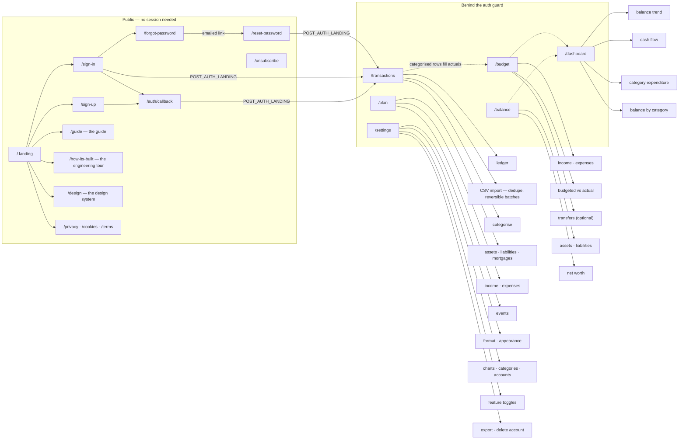

# Sitemap

**What:** Every route the app serves, derived from `src/app/` and the middleware guard — not a plan.  
**Key points:**
- Public pages: `/`, `/sign-in`, `/sign-up`, `/forgot-password`, `/reset-password`, `/guide`, `/how-its-built`, `/design`, `/privacy`, `/cookies`, `/terms`, `/unsubscribe`
- Authenticated pages: `/transactions`, `/budget`, `/balance`, `/dashboard`, `/plan`, `/settings`
- Non-page routes: `/auth/callback`, `/design.md`, `/api/unsubscribe`, `/api/health`, `/api/csp-report`, `/api/cron/monthly-reminder`
- The six authenticated pages are in the proxy's `protectedPaths` list, and each page re-checks the session itself
- If a route is listed here, it exists in the codebase

Every route the app serves, and who can reach it. Derived from `src/app/` and the
guard in [`src/lib/supabase/middleware.ts`](../src/lib/supabase/middleware.ts),
which `src/proxy.ts` runs on every request.



## Route groups

Routes live in two App Router groups. The groups shape nothing in the URL; they
decide which layout wraps the page, and that turns out to matter for
performance:

- **`(marketing)`** — the landing page alone. Its layout reads no session, which
  is what lets the whole group prerender: no auth round-trip in front of the one
  page a stranger judges the product by.
- **`(app)`** — every other page, public or not. Its layout resolves the user,
  the nav flags and the colour scheme, so it renders per request.

`/auth/callback`, `/design.md` and the `/api/*` routes sit outside both — they
are route handlers, not pages.

## Public

Reachable without a session.

| Route | What it is |
| --- | --- |
| `/` | Landing page. A signed-in visitor is redirected to `/transactions` by the proxy before the page renders, so this is only ever seen signed out. |
| `/sign-in` | Email + password, and "Continue with Google". Accepts `?next=` to return you where you were heading, and `?timeout=idle\|absolute\|unreadable` after a session expiry. Links to `/forgot-password`. |
| `/sign-up` | Account creation, by email + password or "Continue with Google". Supabase Auth owns the password and the confirmation email. |
| `/forgot-password` | Asks for an email address and sends a reset link. The reply is the same whether or not the address has an account. |
| `/reset-password` | Where the emailed link lands (it carries a `token_hash`). Sets a new password, signs the user in and signs out their other sessions. Google-only accounts are refused. |
| `/auth/callback` | Route handler. Exchanges the one-time `code` from OAuth and email confirmation for a session. Refuses password-recovery codes, which belong at `/reset-password`. |
| `/guide` | The guide — what the app is for, the monthly rhythm, and what each section does. Deliberately public: it is the honest answer to "what is this?" before signing up. |
| `/how-its-built` | The engineering tour — every feature of the build, with what it does, why it matters and how it is implemented. Public on purpose: it is the page to hand to someone who wants to know whether this is trustworthy. |
| `/design` | The design system, rendered live from `DESIGN.md`: colour tokens, type scale, spacing and component patterns. Public like the guide. |
| `/design.md` | Route handler. The same `DESIGN.md` as raw Markdown, for pointing a tool at. |
| `/privacy` | Privacy notice. |
| `/cookies` | Cookie policy — every cookie the app sets, named, with purpose and lifetime. |
| `/terms` | Terms of service. |
| `/unsubscribe` | Where the monthly reminder email's "stop these reminders" link lands. Needs no session; the token in the URL can only turn one account's reminder off. |

### API routes

Machine endpoints; none is in `protectedPaths`.

| Route | What it is |
| --- | --- |
| `POST /api/unsubscribe` | One-click unsubscribe (RFC 8058), called by mail clients from the reminder's `List-Unsubscribe` header. Token in the query string. |
| `POST /api/csp-report` | Where browsers send Content-Security-Policy violation reports. Counts each in Upstash for 30 days; see ADR-002. |
| `GET /api/health` | Production liveness check (`SELECT 1` through Prisma). Needs the `CRON_SECRET` bearer token; called daily by `.github/workflows/health.yml`. |
| `/api/cron/monthly-reminder` | The daily Vercel Cron job that sends due monthly reminders. Needs the `CRON_SECRET` bearer token. |

## Behind the auth guard

Listed in `protectedPaths` in the proxy. A request without a confirmed session is redirected to `/sign-in?next=<path>`.

| Route | What it is |
| --- | --- |
| `/transactions` | The ledger. CSV import (duplicate detection, reversible batches) and categorisation. Where users land after signing in. Hidden from the nav when the Transactions setting is off. |
| `/budget` | Per-period budgeted against actual, across four row kinds: income and expenses (split Fixed / Variable / Discretionary), repayments at a debt (inside Expenses), and transfers to an account you own (their own section). |
| `/balance` | Per-period assets and liabilities, one row per account, grouped into sections (Current, Medium-term, Long-term, Property, Other), totalling to net worth. |
| `/dashboard` | Read-only. Balance trend, cash flow, category expenditure and balance-by-category, drawn from the months filled in elsewhere. |
| `/plan` | Long-range forecasting — income, spending, property, mortgages and pensions projected decades ahead. Refreshed from the balance sheet and budget by an explicit Sync. |
| `/settings` | Currency and number format, colour scheme, chart visibility, categories, accounts, transactions and transfers toggles, monthly reminder, change password (password accounts only), and data export / account deletion. |

## Navigation

The signed-in nav leads with the guide, then follows how the app is used —
import, categorise, budget, balance, then read the result:

```
Guide → Transactions → Budget → Balance → Dashboard → Plan → Settings
```

Transactions drops out when the Transactions setting is off. Signed out, the landing page's bar carries its section anchors plus Guide, other pages carry Guide alone, and `/guide`, `/sign-in` and `/sign-up` carry only the brand. App pages share a footer linking the guide, design system, engineering tour and legal pages.

There is deliberately no "Home" entry: signed-in users are redirected away from
`/`, so it would only ever point at a redirect.

## Not built

- **Blog** — was listed here for a long time as planned. Nothing exists, and
  nothing is scheduled; it is noted only so its absence isn't mistaken for an
  oversight.
