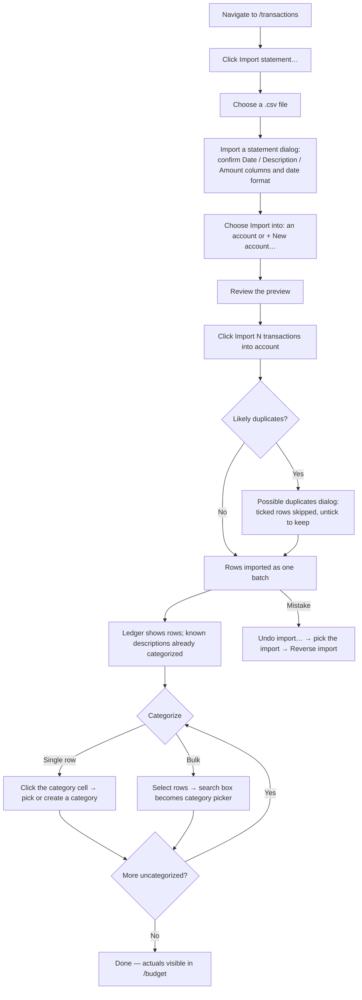

# User Journey: Import Transactions and Categorize

**Journey:** A user imports a bank statement CSV, reviews it, and categorizes the transactions.  
**Outcome:** Transactions stored, likely duplicates skipped or kept by choice, every row categorized, actuals visible in `/budget`.

Requires the Transactions setting to be on. When it is off, the nav link is hidden and `/transactions` redirects to `/dashboard`. See [features/transactions.md](../features/transactions.md) for the full spec.

## Flow

## Steps

### Import a statement

1. On `/transactions`, click **Import statement…** and choose a `.csv` file. Limits: 5,000 rows and 2 MB per import.
2. The **Import a statement** dialog opens with the date, description and amount columns detected. Change them, the date format, or the extra columns to keep if the guess is wrong.
3. Under **Import into**, pick an importable account, or **+ New account…** and name it.
4. Check the preview. Rows with errors show in the Status column and are skipped.
5. Click **Import N transactions into <account>**.

### Duplicates

A row is a likely duplicate when an existing transaction in the same account has the same date, amount and description (compared case-insensitively with spaces collapsed). If any are found, **Possible duplicates** lists them. They start ticked, meaning skipped. Untick the ones that are genuinely separate, then click **Import N new** (or **Import N new, skip M**). Nothing is dropped without being shown.

### Auto-categorization

On import, each row whose description matches one you categorized before takes that category. The result toast reports the count, for example "Imported 40 into Current account, 12 auto-categorised".

### Categorize

When rows lack a category, the ledger header shows "N uncategorized — assign a category below". Two ways to fix:

- **Single:** click a row's category cell and pick a category. The picker can also create a category or mark the row as a transfer to another account.
- **Bulk:** tick rows. The search box becomes a category picker; applying it sets the category on all selected rows.

Categorized transactions feed the **Actual** column in `/budget` for their category and month.

### Add one by hand

**Add transaction** (direction, amount, description, date, account, category) records a single entry with no statement, for example cash spending.

### Undo an import

Click **Undo import…**, choose the import from the list, and click **Reverse import (delete N)** in the "Reverse an import" dialog. Every transaction from that import leaves the ledger, budget actuals and dashboard, along with any categories or notes on those rows. There is no undo.
