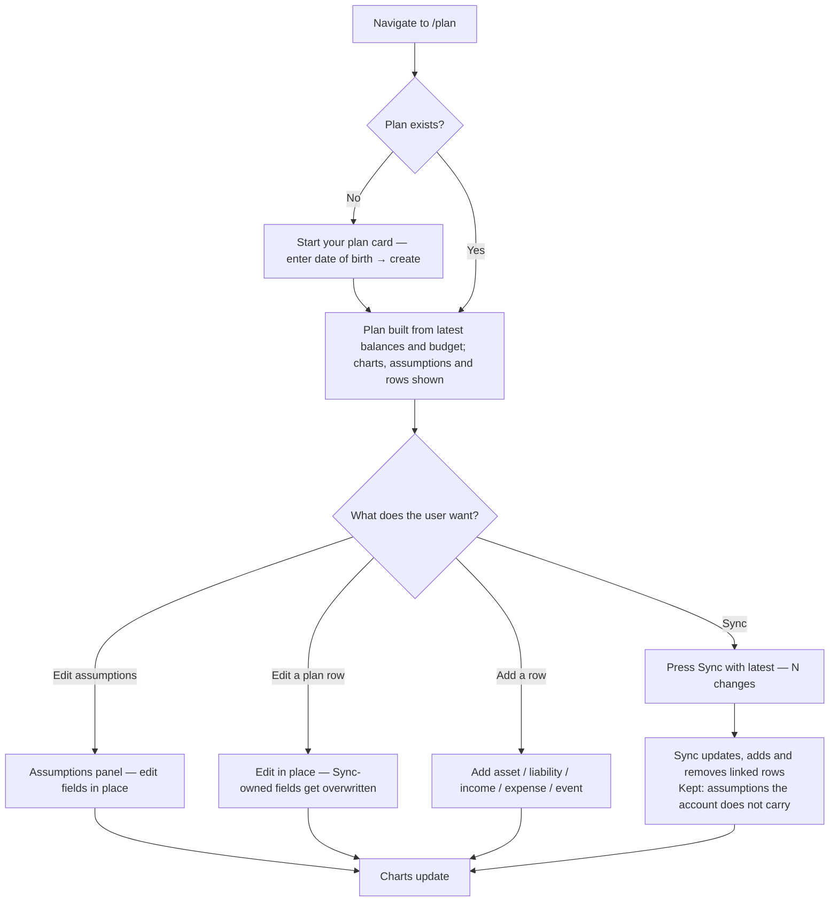

# User Journey: Sync the Plan

**Journey:** A user edits their long-range plan, then presses Sync to pull in their latest balances, budget flows and account terms.  
**Outcome:** Plan rows match the user's live accounts and budget; projection charts updated.

See [features/plan-sync.md](../features/plan-sync.md) for exactly what Sync replaces and keeps.

## Flow

## Steps

### First plan

With no plan, `/plan` shows **Start your plan**. Enter a date of birth and create. Creation is a Sync against an empty plan: it reads each account's latest balance and the budget's transfers, repayments, income and expenses. Every other assumption starts at a default.

### Edit assumptions

The **Assumptions** panel holds: Date of birth, Retirement age, Plan to age, Inflation %, Default return %, Return spread ±%, Tax regime (rest of UK or Scotland), Tax bands rise with inflation, State pension age, State pension / yr, Expected age at death. Changes save as you edit and the charts update.

### Edit or add plan rows

Assets, Liabilities, Income, Expenses and One-off events each have a card with editable fields and an add button (**Add asset**, **Add liability**, **Add income**, **Add expense**, **Add event**). A marker on each linked row shows its Sync state: `✓` in step, `●` changed since last Sync, `◇` Sync will remove it.

Fields Sync owns are overwritten the next time you run it: labels, values, the budgeted monthly flow (`monthlyContribution`, `monthlyRepayment`) and the account terms feeding the row (return, fees, interest rate, minimum access age and so on). Fields Sync keeps include drawdown priority, contribution end age, growth kind, taxable flag, income and expense start and end ages, and all assumptions and events. To keep a custom value on a Sync-owned field, change it on the account or budget instead.

### Run Sync

The button reads **Sync with latest — N changes**, with a breakdown (`X updated · Y added · Z removed`). When nothing differs it reads **Up to date** and is disabled.

- Rows for accounts or categories that no longer exist are removed.
- Rows for new accounts or categories are added.
- Plan-only rows (not linked to an account or category) are removed. Sync asks you to confirm first when this would remove something you added by hand.

Sync reads each account's latest recorded balance and the latest budget flows, so update those first.

### After Sync

The charts (Net worth, Cash flow, Liquid assets) and the Timeline update straight away.
