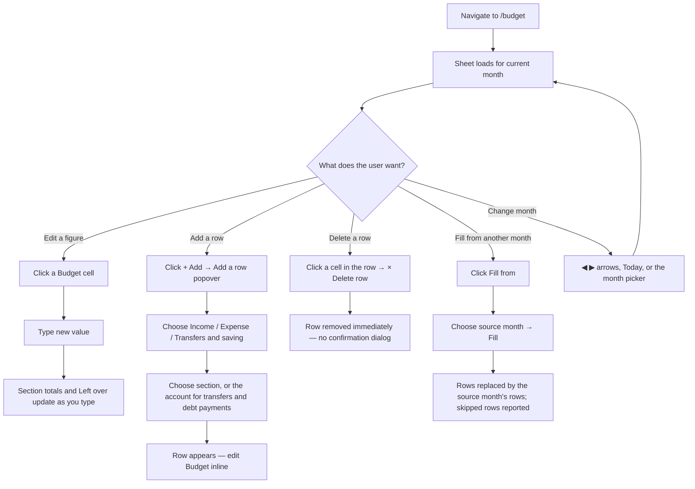

# User Journey: Update a Budget

**Journey:** A user opens the budget sheet and enters their planned figures for the month.  
**Outcome:** Budgeted amounts saved; Left over total updated; actuals shown beside the plan.

The budget is an inline spreadsheet grid with no pop-up forms. Edits save automatically (debounced 500 ms, committed on blur). A status pip in the toolbar shows `Saving…`, `Saved <time>` or `Failed — <reason>`. See [features/budget.md](../features/budget.md) for the data model.

## Flow

## Steps

### Layout

Columns are **Category**, **Budget**, **Actual** and **Notes**. Rows group into:

- **Income**, in sections Salary, Side income, Investments, Pensions, Other.
- **Expenses**, in sections Fixed, Variable, Discretionary, then **Debt payments** (repayments at a liability account).
- **Transfers and saving** (to an asset account you own).
- **Left over**, a total row for the month.

A summary table of recent months (Month, Income, Expenses, Net) appears below the sheet once more than one month exists.

### Edit a figure

1. Click a **Budget** cell and type.
2. Totals recalculate as you type; the value saves shortly after you stop.
3. Arrow keys and Tab move between cells. **Enter** moves to the same cell one row down; at the end of a section it adds a new row.

### Add a row

1. Click **+ Add**. The **Add a row** popover opens.
2. Choose **Income**, **Expense** or **Transfers and saving**, then the section. Under Expense, **Debt payment** is the fourth choice.
3. Income and Expense rows take a name. Transfers and debt payments pick an account instead; each account gets one row per month. With no suitable account, the popover offers **Add one now**.

### Delete a row

Click any cell in the row, then **× Delete row** in the toolbar. The row goes at once, with no confirmation.

### Fill from another month

1. Click **Fill from** and choose a source month.
2. Confirm with **Fill**. The popover warns that this replaces the rows in the current month, carries budgeted amounts over and resets actuals to 0.
3. Rows anchored to accounts that have since been archived, deleted or re-typed are skipped, and a notice reports how many.

### Change month

Use **◀** and **▶** for one month, **Today** to return to now, or the month label to pick a month and year. A month's sheet exists in the database only once you add or fill a row; before that it shows empty.

## What the Actual column shows

With the Transactions setting **on**, Actual is read-only and computed from the ledger:

- Income and expense rows: the net of transactions categorised to that category in the month.
- Transfer and debt-payment rows: the net flow on that account from transfer-tagged transactions.

With Transactions **off**, Actual is a typed figure you edit like Budget.
