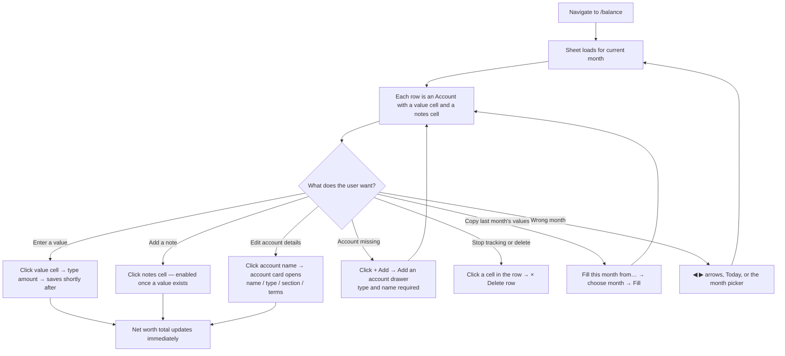

# User Journey: Update Balance Sheet

**Journey:** A user opens the balance sheet and records the current value of each account for the month.  
**Outcome:** Account values entered; net worth updated; Plan Sync can read these as opening figures.

## Flow

## Steps

### Enter a value

Click a value cell and type the current balance. The value saves shortly after you stop typing, and the **Net worth** row updates immediately. Assets and liabilities each have a subtotal, grouped into the account's section (Current, Medium-term, Long-term, Property, Other).

### Add a note

A note describes the month's figure, so the notes cell is disabled until the row has a value. Type to save.

### Edit account details

Click the account **name** to open the account card. From there: rename, change type or section, and edit the terms that feed Plan Sync (expected return, fees, interest rate and so on; which fields appear depends on the type). Value and notes stay editable on the sheet.

### Account missing

Click **+ Add**. The **Add an account** drawer asks "What are you adding?" (an asset or liability type), then a name, a section and the value now. The type decides which terms are offered: a mortgage asks for interest rate, interest-only, revision date and rate, and end date; a SIPP asks for expected return, fees and minimum access age.

### Stop tracking or delete an account

Click a cell in the row, then **× Delete row**. A panel offers **Stop tracking it** (the account leaves this month's sheet; closed months keep their values; restorable from Settings) or **Delete it everywhere** (removes every monthly value and the budget transfers pointing at it; cannot be undone, and you type `DELETE` to confirm).

### Fill from another month

Click **Fill this month from…**, choose a month, and confirm with **Fill**. Every line carries over with its value, dimmed until you update it. Filling replaces any values already in the month.

### Past periods

Use **◀** and **▶**, **Today**, or the month label to move between months. Past months stay editable; there is no read-only lock. Editing one changes the balance trend on `/dashboard`. A summary table of months (Assets, Liabilities, Net Worth) appears under the sheet once more than one month exists.
